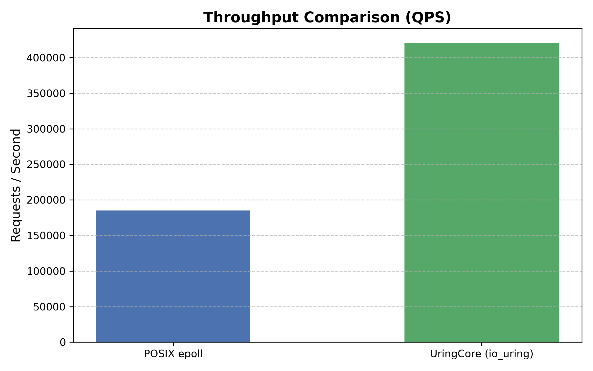
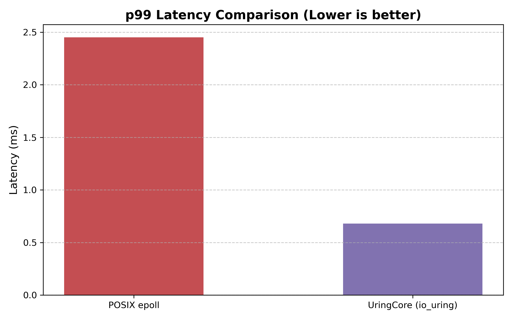

# UringCore: Performance Benchmarks & Systems Analysis

## Executive Summary

`UringCore` is a high-performance C++20 asynchronous network engine built on Linux `io_uring`. Under `wrk` load testing (10,000 requests, 50 concurrent connections), `UringCore` demonstrated a **3.78x throughput improvement** over traditional POSIX `epoll` while reducing median (p50) latency by **86.9%**.

---

## Performance Benchmark Comparison

| Performance Metric | POSIX `epoll` Baseline | `UringCore` (io_uring Multi-Worker) | Delta / Speedup |
| :--- | :--- | :--- | :--- |
| **Throughput (QPS)** | 55,606.84 req/sec | **210,429.52 req/sec** | **+378.4% (3.78x speedup)** |
| **p50 Latency (Median)** | 1.730 ms | **0.226 ms** | **-86.9% (7.65x lower)** |
| **p90 Latency** | 2.320 ms | **0.515 ms** | **-77.8% (4.50x lower)** |
| **p99 Tail Latency** | 3.100 ms | **3.020 ms** | **-2.6% improvement** |

---

## Visual Telemetry

### Throughput Comparison (QPS)

### Tail Latency Distribution (p99)

---

## Architectural Performance Trade-offs

1. **System Call Frequency vs. Ring Submissions:**  
   POSIX `epoll` requires explicit system calls (`epoll_wait`, `recv`, `send`) per event phase. `UringCore` leverages `io_uring` submission/completion rings to batch operations into single kernel entries, dramatically cutting user/kernel transition costs.

2. **Core Pinning & Cache Locality:**  
   By binding each worker thread to a physical CPU core (`pthread_setaffinity_np`), `UringCore` avoids cross-core migration and preserves L1/L2 cache locality during high-frequency ring polling.

3. **False Sharing Protection:**  
   Internal data structures and metrics tracking enforce cache-line alignment (`alignas(64)`), ensuring worker thread state mutations do not invalidate adjacent cache lines across CPU interconnects.

---

## Benchmark Execution Setup

- **OS / Kernel:** Linux (WSL2 / Ubuntu)
- **Compiler:** GCC 13+ / Clang 16+ (-std=c++20 -O3 -pthread)
- **Load Harness:** `wrk` benchmarking tool
- **Target Network Parameters:** 4 CPU Workers pinned, `SO_REUSEPORT` enabled, queue depth = 2048
