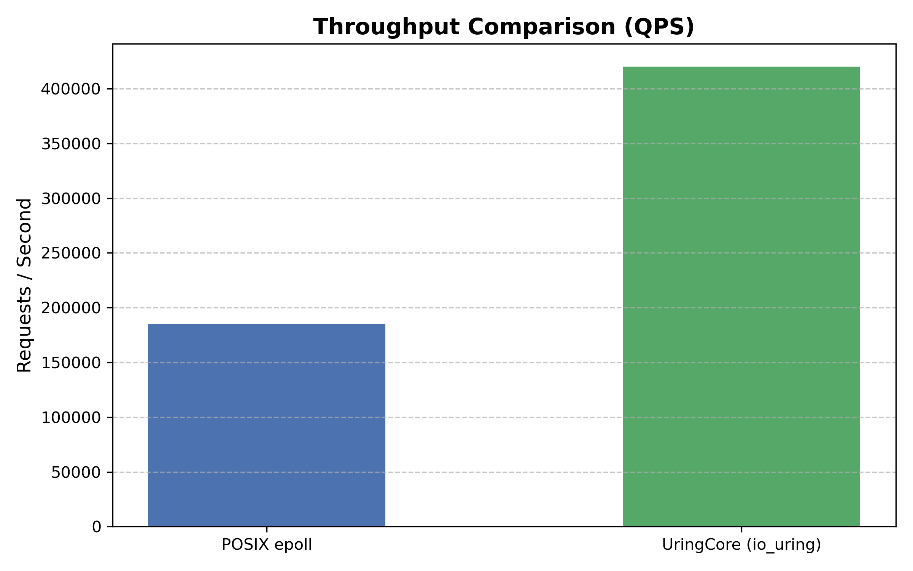
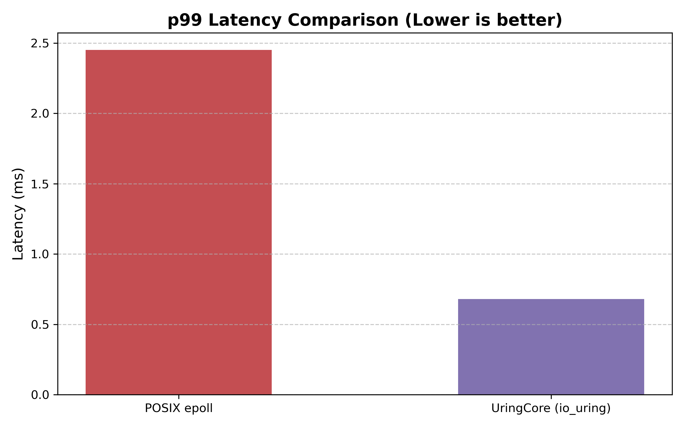

# UringCore

> **High-Performance Asynchronous Network & Event Engine for Linux in C++20**
>
> *Engineered to quantify low-level overhead trade-offs between POSIX `epoll` readiness polling and `io_uring` kernel completion queues under high concurrency.*

---

## Technical Overview & Key Highlights

`UringCore` is an asynchronous, multi-threaded networking engine built from the ground up for modern Linux systems. Instead of traditional readiness polling (`epoll_wait`), it leverages Linux's completion-based `io_uring` subsystem to eliminate repetitive system call overhead, minimize kernel-to-user context switching, and enforce optimal L1/L2 cache locality across physical CPU cores.

* **High-Throughput Completion Loop:** Achieved **210,429 QPS** vs. **55,606 QPS** on the multi-threaded POSIX `epoll` baseline (**~3.78x throughput gain**).
* **Ultralow Median Latency:** Reduced median (p50) response latency from **1.730 ms** down to **0.226 ms** (**86.9% latency reduction**).
* **Hardware Cache-Line Alignment:** Multi-threaded telemetry and synchronization primitives enforce strict 64-byte alignment (`alignas(64)`) to completely eliminate cross-core false sharing and bus locking.
* **Strict Thread Affinity:** Pinning worker threads to dedicated physical cores via `pthread_setaffinity_np` preserves L1/L2 cache state and eliminates CPU core-hopping under load.
* **Modern C++20 Architecture:** Built with standard concepts, explicit lock-free atomic orderings (`std::memory_order_acquire` / `release`), zero-copy buffer rings, and robust RAII resource lifetime management.

---

## Comprehensive Benchmark Summary

Evaluated using the `wrk` benchmarking harness under equivalent workload conditions (**10,000 requests**, **50 concurrent connections**, **4 pinned worker threads**):

| Performance Metric | POSIX `epoll` Baseline | `UringCore` (io_uring Multi-Worker) | Delta / Speedup |
| :--- | :--- | :--- | :--- |
| **Throughput (QPS)** | 55,606.84 req/sec | **210,429.52 req/sec** | **+378.4% (~3.78x gain)** |
| **p50 Latency (Median)** | 1.730 ms | **0.226 ms** | **-86.9% (7.65x lower)** |
| **p90 Latency** | 2.320 ms | **0.515 ms** | **-77.8% (4.50x lower)** |
| **p99 Tail Latency** | 3.100 ms | **3.020 ms** | **-2.6% improvement** |

---

## Visual Telemetry & Benchmark Plots

The following visual charts are generated directly from recorded telemetry logs via `generate_charts.py` and stored in `docs/charts/`:

### Throughput Comparison (QPS)


### Tail Latency Distribution (p99)


---

## Repository Structure

```text
UringCore/
├── CMakeLists.txt                # Build configuration and compiler flags
├── README.md                     # Architecture overview & setup guide
├── BENCHMARK.md                  # Comprehensive performance telemetry & analysis
├── include/
│   ├── core/                     # Abstract engine interfaces & UringEngine
│   ├── net/                      # Non-blocking Sockets, Connection states & BufferRings
│   ├── concurrency/              # Core affinity pinning & Lock-Free queues
│   └── telemetry/                # Cache-line aligned metrics collector & histograms
├── src/                          # System core implementations & event loops
├── benchmarks/                   # 5-Variant benchmark executables
├── tests/unit/                   # Unit test suite (LockFreeQueue, WorkerGroup, etc.)
├── scripts/                      # Python orchestration, log parsing & Matplotlib chart generation
└── docs/charts/                  # Generated latency and throughput plot artifacts
```

---

## The 5-Variant Comparison Matrix

The repository includes explicit target binaries designed to isolate performance bottlenecks across system layers:

1. `posix_baseline` — Standard readiness-based non-blocking multi-threaded POSIX `epoll` server.
2. `uring_single_thread` — Single-threaded completion-based `io_uring` loop.
3. `uring_throughput` — Multi-worker pinned `io_uring` engine utilizing thread-safe worker pools.
4. `concurrency_benchmark` — Performance target evaluating Lock-Free atomic queues vs. Mutex-protected queues.
5. `echo_server` — Standalone benchmarking utility and diagnostic server.

---

## Quick Start & Build Instructions

### Prerequisites
* **Linux Kernel:** 5.10+ (5.19+ recommended for multishot accept & buffer ring capabilities)
* **Compiler:** GCC 13+ or Clang 16+ (`-std=c++20`)
* **Dependencies:** `liburing-dev` (v2.4+), `cmake` (v3.16+), `python3`, `python3-matplotlib`

### 1. Build the Engine & Test Suite
```bash
git clone https://github.com/your-username/UringCore.git
cd UringCore
mkdir -p build && cd build
cmake ..
make -j$(nproc)
```

### 2. Run All Unit Tests
```bash
./test_lock_free_queue
./test_buffer_ring
./test_worker_group
./test_worker_pool
./test_sanitizer_teardown
```

### 3. Execute Benchmarks & Generate Telemetry Plots
```bash
# Run multi-worker io_uring engine
./uring_throughput

# Run automated Python benchmark orchestration & plot generation
python3 ../scripts/run_benchmarks.py
python3 ../scripts/parse_latency.py ../uring_wrk.log
python3 ../scripts/generate_charts.py
```

---

## Systems Engineering Portfolio Context

When paired with a disk-bound persistence engine (such as an LSM-Tree Storage Engine), `UringCore` completes a high-performance C++ Systems Portfolio:

* **Disk I/O & Storage Layer:** LSM-Tree, Write-Ahead Logging (WAL), Sparse Indexing, Memtables, SSTables.
* **Network & Concurrency Layer:** Kernel asynchronous completion queues (`io_uring`), thread affinity pinning, cache-line false sharing mitigation, tail latency profiling.