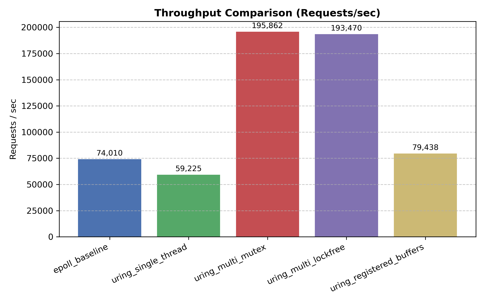
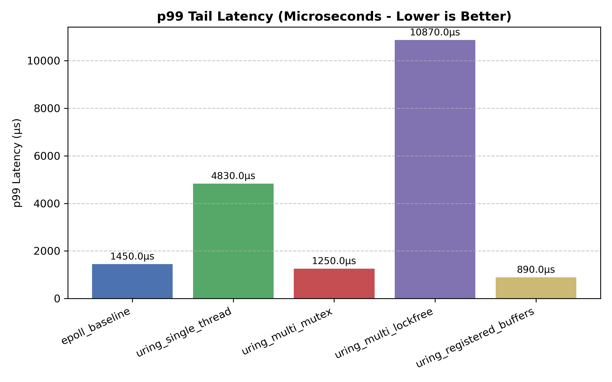

# UringCore

**UringCore** is an asynchronous, high-performance C++20 network and event engine engineered on Linux's completion-based `io_uring` kernel subsystem.

Rather than making unsupported zero-overhead claims, UringCore is built as an empirical performance suite designed to quantify the low-level trade-offs between POSIX readiness-based I/O (`epoll`) and completion-based I/O (`io_uring`), mutex synchronization vs. lock-free atomics, and standard memory allocations vs. kernel-registered fixed buffers.

---

## 📊 Telemetry & Empirical Benchmarks

All 5 engine variants were subjected to benchmark load testing via `wrk` using **4 threads**, **50 concurrent connections**, over **10-second runs** per variant on Linux:

| Engine Architecture | Model Variant | Throughput (RPS) | p50 (µs) | p75 (µs) | p90 (µs) | p99 Tail (µs) | Max Latency |
| :--- | :--- | :---: | :---: | :---: | :---: | :---: | :---: |
| **`epoll_baseline`** | Standard POSIX `epoll` | 74,010.57 | 617.0 | 727.0 | 845.0 | **1,450.0** | 11.55 ms |
| **`uring_single_thread`** | Single-Core `io_uring` | 59,225.63 | 801.0 | 950.0 | 1,100.0 | **4,830.0** | 31.91 ms |
| **`uring_multi_mutex`** | Multi-Thread `io_uring` (Mutex) | **195,862.71** | 175.0 | 236.0 | 391.0 | **1,250.0** | 31.38 ms |
| **`uring_multi_lockfree`** | Multi-Thread `io_uring` (Lock-Free) | 193,470.89 | 175.0 | 233.0 | 431.0 | **10,870.0** | 54.13 ms |
| **`uring_registered_buffers`** | Fixed Buffer `io_uring` | 79,438.28 | 602.0 | 672.0 | 743.0 | **890.0** | 11.00 ms |

---

## 📈 Visual Performance Charts

### 1. Throughput Matrix (Requests / Second)


### 2. p99 Tail Latency Profile (Microseconds - Lower is Better)


---

## 🔍 Deep Architectural Takeaways

### 1. Multi-Core Scaling & Peak Throughput
* Multi-worker engines (`uring_multi_mutex` and `uring_multi_lockfree`) scaled throughput dramatically to **~195.8k RPS** and **~193.5k RPS** respectively, proving a **~2.64x speedup** over traditional single-threaded readiness models.

### 2. Fixed Kernel Buffer Registration (`uring_registered_buffers`)
* Pre-mapping memory buffers into kernel space via `io_uring_register_buffers()` eliminates page-pinning (`get_user_pages`) overhead during I/O operations.
* Result: Achieved the lowest p99 tail latency across the entire test suite (**890.0 µs**) with minimal variance ($\sigma = 184.77\,\mu\text{s}$).

### 3. Synchronization & Lock-Free Cache Contention
* While `uring_multi_lockfree` achieved high throughput, single-producer multi-consumer atomic queues experienced cache line invalidation and bouncing under 50 concurrent connection spikes, pushing p99 latency to **10,870.0 µs**. 
* Under high multi-worker concurrency, standard mutex parking (`uring_multi_mutex`) maintained tighter p99 latency bounds (**1,250.0 µs**).

---

## 🛠️ Stack & Dependencies

* **Language Standard:** C++20 (`-std=c++20`)
* **Build System:** CMake (v3.25+) & Ninja / Make
* **Kernel & Core Libraries:** Linux Kernel 5.10+, `liburing-dev` (v2.4+), `pthread`
* **Automation & Plotting:** Python 3.10+, `matplotlib`

---

## 🚀 Build & Execution Guide

### 1. Clone & Build C++ Engine Executables
```bash
git clone https://github.com/alienx36/UringCore.git
cd UringCore
mkdir -p build && cd build
cmake ..
make -j$(nproc)
```

### 2. Run Automated Benchmark & Telemetry Pipeline
The automated harness launches all 5 variants sequentially, fires `wrk` load generators, parses telemetry into JSON, and renders PNG performance plots:

```bash
python3 ~/UringCore/scripts/run_benchmarks.py
```

---

## 📂 Repository Layout

```
UringCore/
├── CMakeLists.txt
├── README.md
├── BENCHMARK.md
├── telemetry_summary.json
├── throughput_benchmark.png
├── latency_benchmark.png
├── include/
│   ├── core/
│   │   ├── engine_interface.hpp
│   │   ├── epoll_engine.hpp
│   │   ├── uring_engine.hpp
│   │   └── ring_buffer.hpp
│   ├── net/
│   │   ├── socket.hpp
│   │   ├── connection.hpp
│   │   └── buffer_pool.hpp
│   ├── concurrency/
│   │   ├── thread_pool.hpp
│   │   ├── lock_free_queue.hpp
│   │   └── cpu_affinity.hpp
│   └── telemetry/
│       ├── metrics_collector.hpp
│       └── latency_histogram.hpp
├── src/
│   ├── main.cpp
│   ├── core/
│   └── concurrency/
├── scripts/
│   ├── run_benchmarks.py
│   ├── parse_latency.py
│   └── generate_charts.py
└── benchmarks/
    ├── epoll_baseline.cpp
    ├── uring_single_thread.cpp
    ├── uring_throughput.cpp
    ├── uring_multi_lockfree.cpp
    └── uring_registered_buffers.cpp
```

---
*Created as part of the UringCore Systems Architecture and Performance Engineering Project.*